# SAVIA — examen N.º 1

Proyecto estático HTML + CSS. Abrir `index.html` en el navegador. No necesita dependencias.

El sitio incluye la página Inicio y las plantillas `pages/menu.html`, `pages/equipo.html` y `pages/eventos.html` con contenido central pendiente. Siga exclusivamente las especificaciones del examen para conocer el comportamiento esperado. No modifique el tema general ni sustituya el proyecto por otro.

## Diagnóstico de cinco incidencias

| N.º | Comportamiento observado | Causa técnica y ubicación | Corrección realizada | Prueba de verificación | Autor |
|---|---|---|---|---|---|
| 1 | Tres tarjetas una debajo de otra| se estaba utilizando flex, style.css linea 123|se cambio  display grid  se uso grid-template-columns|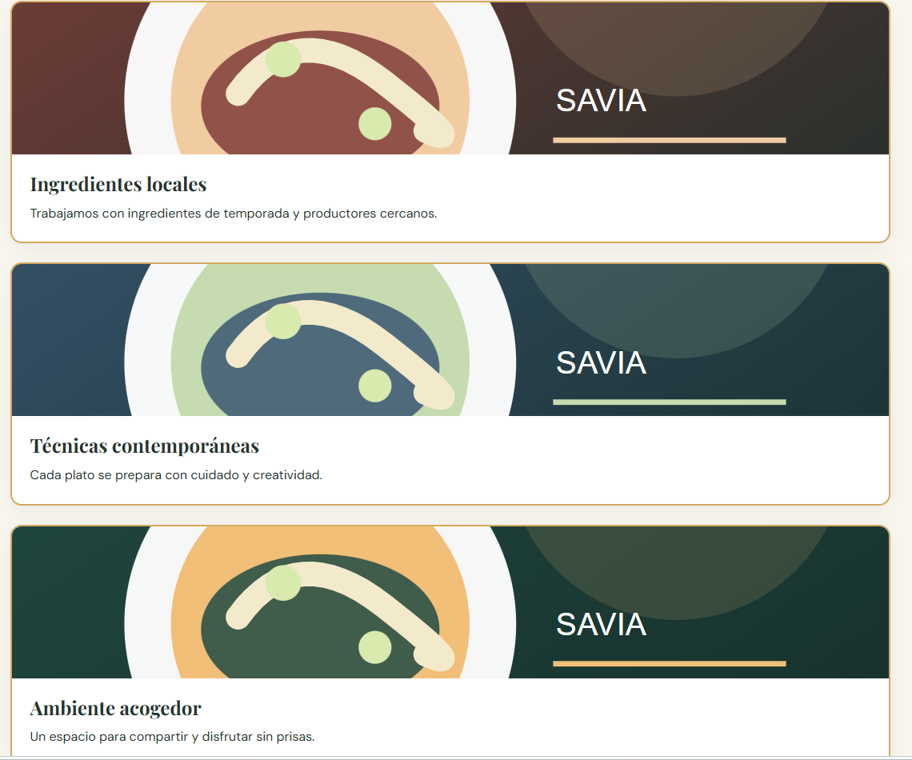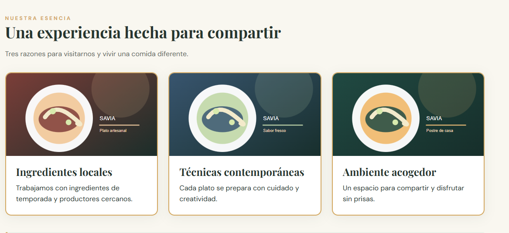  | Angely, Amanda, Valeria|
| 2 |Al sleccionar nuestra carta dirigia eventos, no tenia navbar |tenia una una direccion de pagina incorrecta y tanto en eventos, menu y equipos hacia falta el navbar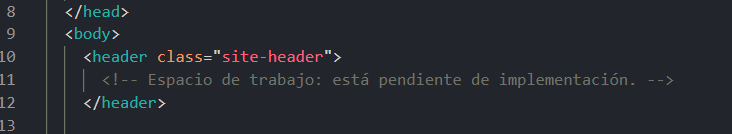 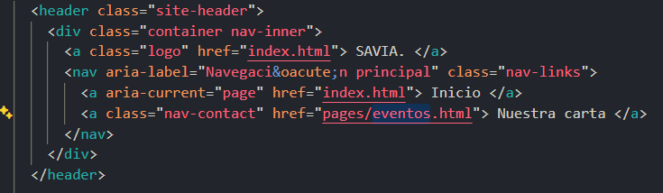|Se corrigio la ruta y cada una de las pantallas se agrego el nav 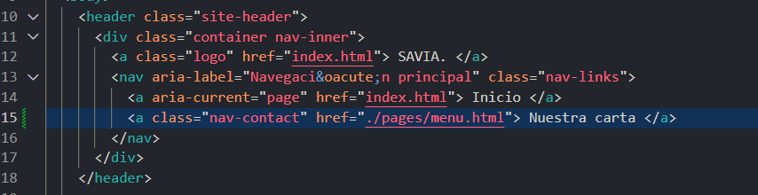 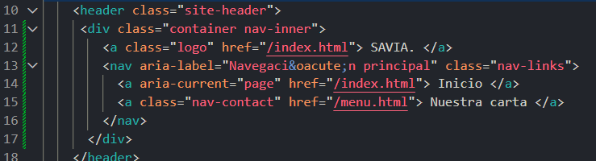 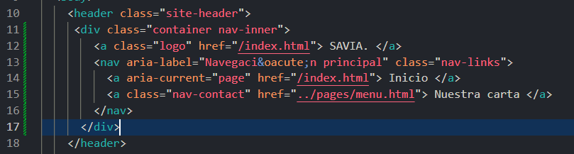 |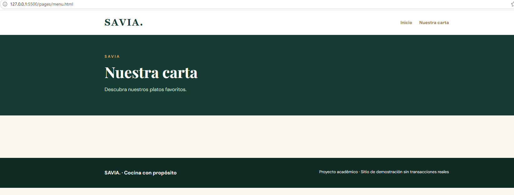 |  Angely, Amanda, Valeria|
| 3 |Al dar click no dirigia a nuestra carta |La direccion estaba incompleta 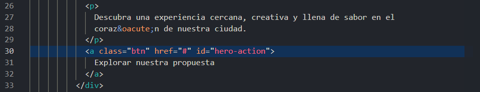| en la linea 30 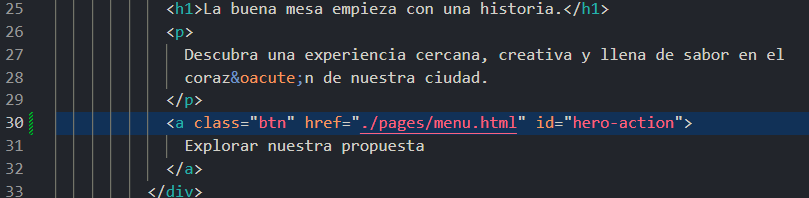| 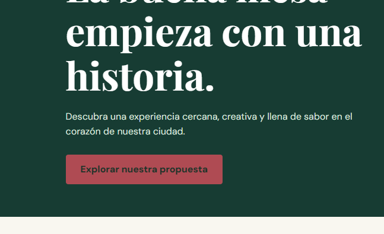| Angely, Amanda, Valeria |
| 4 | El boton esta rojo|El btn tenia estilo del id incorrecto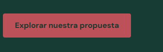 |El id tenia un color distinto, se puso una variable adecuada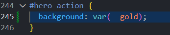 |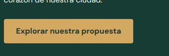 | Angely, Amanda, Valeria |
| 5 |Todo se encontraba en una sola linea |Se veia todo en una sola linea, porque el media el max esta para 750px no 375px 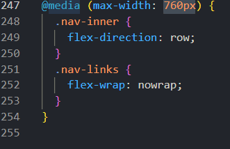 | Se cambio el 750px por 375px 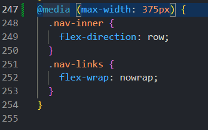|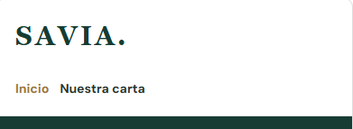 |  Angely, Amanda, Valeria|

## Responsables de las funcionalidades

| Estudiante | Página asignada | Rama | Commits principales |
|Angely|Feature 1 - Carta interactiva|feature/angely|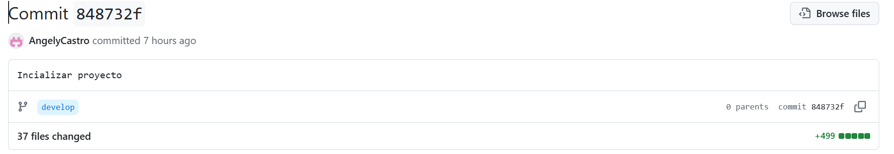 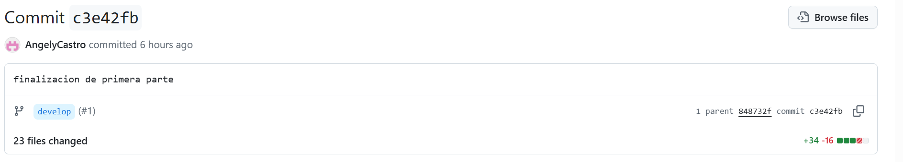|
|Valeria|Feature 2 - Equipo |feature/valeria|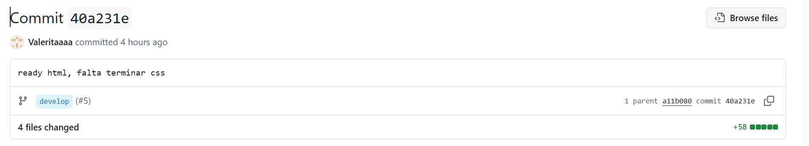 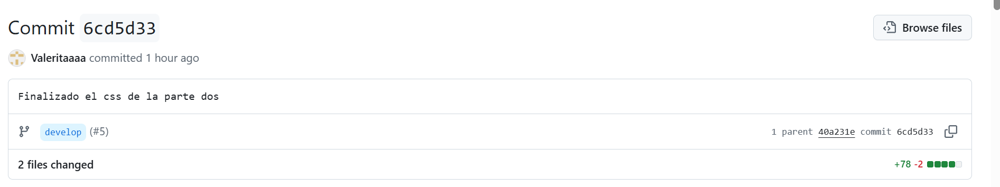|
|Amanda|Feature 3 - Agenda |feature/amanda |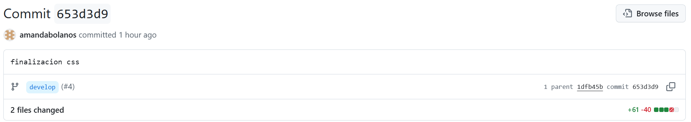 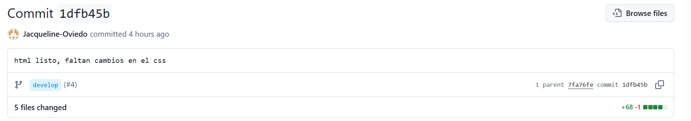 |

## Evidencias Git

| Funcionalidad/corrección | PR hacia develop | Revisor | Resultado de merge / conflicto si ocurrió |
|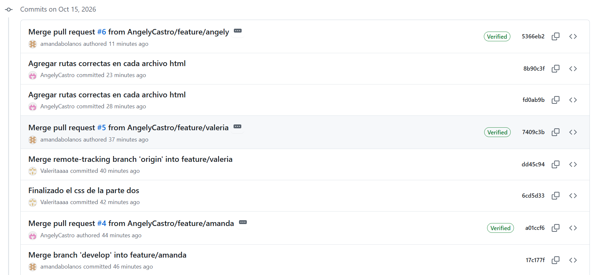 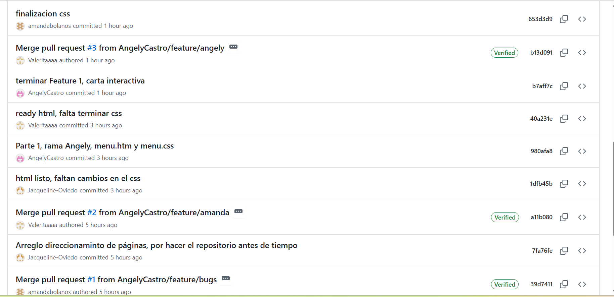 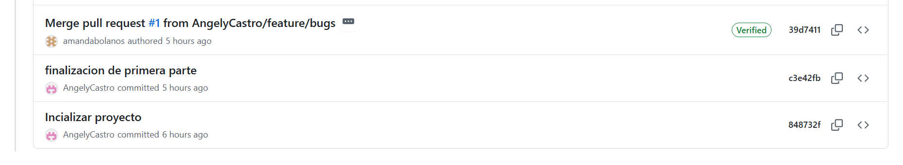|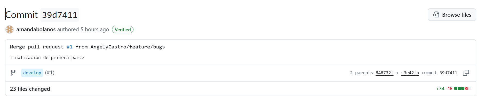 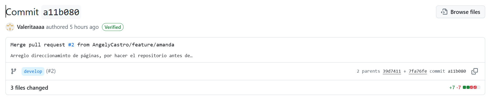 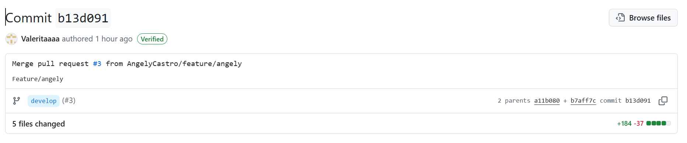 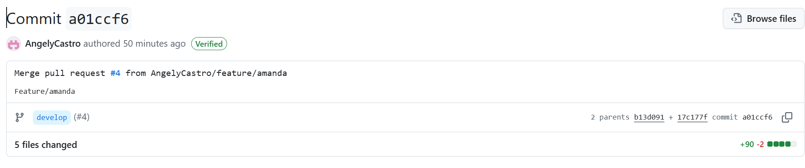 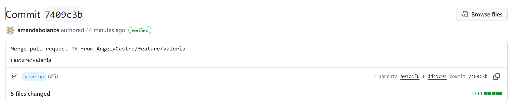 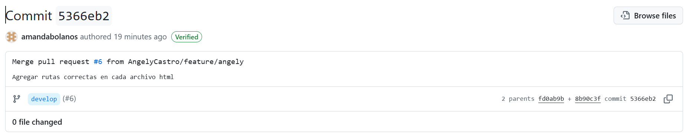 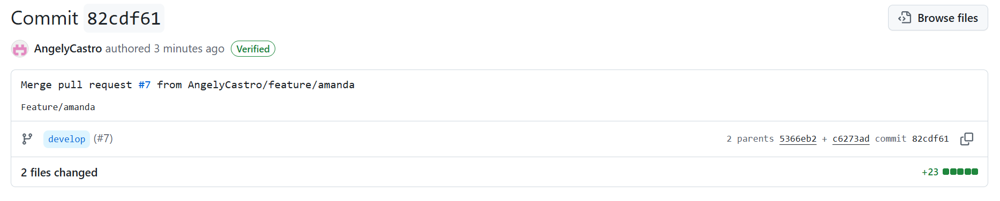|Se muestra en la captura de la columna de PR hacia develop|NO hubo conflictos.|

## Verificación final
Registrar las pruebas de funcionamiento a 1280 px y 375 px, enlaces y páginas.
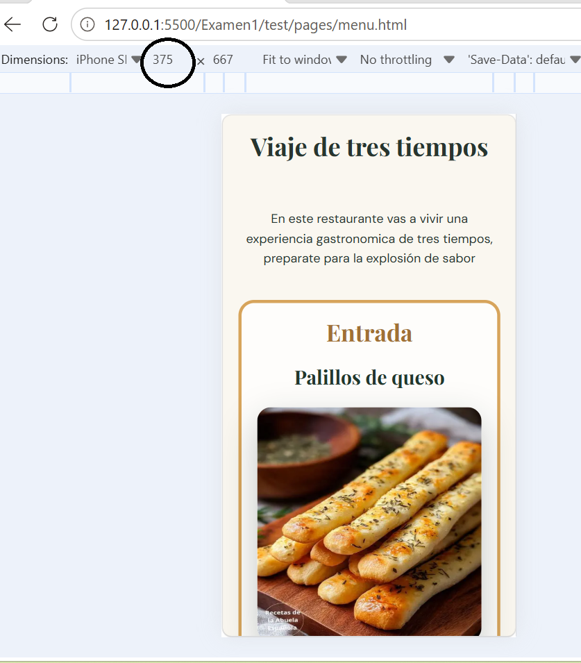
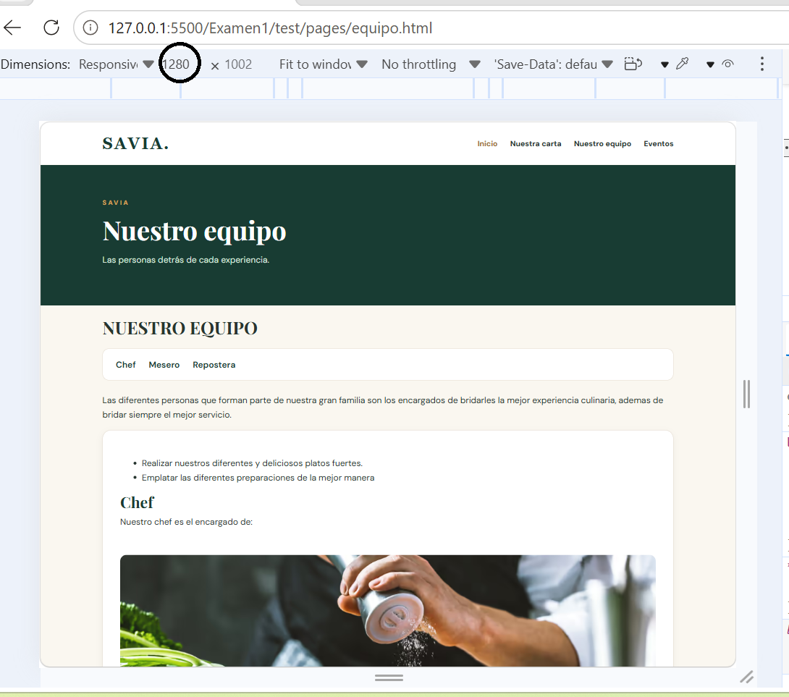
Enlaces: 
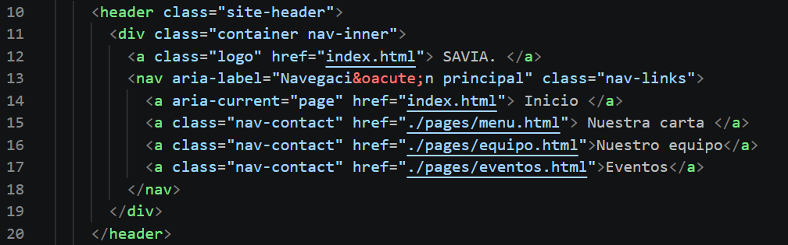
Páginas: 
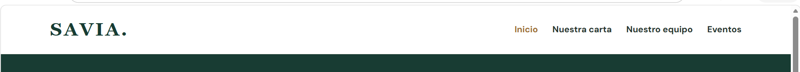